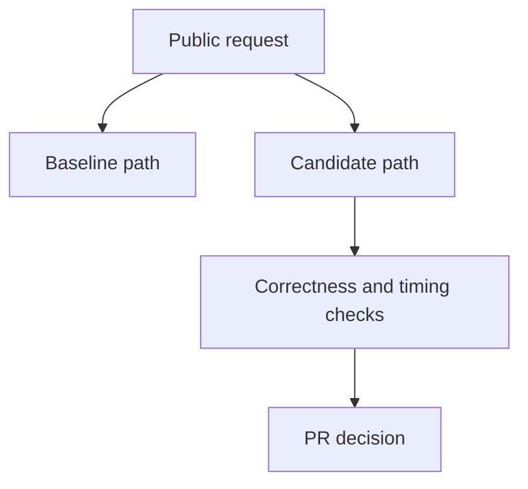

# RFC Design

## Problem

Describe the public issue or PR motivation.

## Proposal

Explain the public change and link to public source files or commits.

## Flow

## Compatibility

- Public API impact:
- Runtime impact:
- Fallback behavior:

## Risks

- Correctness:
- Performance:
- Maintenance:
