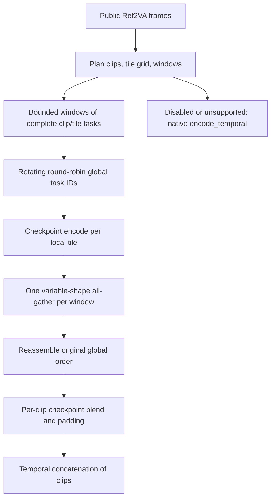

# RFC Design: Cross-Clip Video VAE Tile Balance

## Problem

MiniMax-H3 reference-video encoding splits each temporal clip into a fixed
spatial tile grid. The existing parallel path processes one clip at a time and
assigns tiles to ranks within that clip. When the number of tiles is not a
multiple of the rank count, some ranks take one more tile than others, and that
imbalance repeats for every clip. With 28 tiles per clip over eight ranks in the
tested grid, each clip leaves four ranks with four tiles and four ranks with
three; over eight clips the per-rank forward count was
32/32/32/32/24/24/24/24 per request. The slowest rank therefore gates each
stage, and the extra work cannot be recovered later because the clip order is
fixed.

This is a public, user-visible latency problem for H3 reference-to-video
inference on Ascend: users need the same output video faster, without any
precision change.

## Proposal

Add one opt-in option, `h3_vae_encode_tile_balance_max_tasks` (positive
integer), routed from `additional_config` through the generic pipeline into the
encode-only video VAE. When it is set and the encode is eligible, the scheduler:

1. Reuses the checkpoint's own `split_tiles`, `encode`, `blend`, `clip_length`,
   `token_drop` and padding helpers so normalization, padding, sampling and
   temporal/spatial blend order are unchanged.
2. Pads the video to a whole number of temporal clips using the checkpoint's
   own last-frame repeat, then forms a global task list of `clip × tile` tasks.
3. Groups **complete clips** into bounded windows of at most `max_tasks` tasks.
   A single clip may exceed the bound; windows are never split inside a clip.
4. Assigns global task IDs round-robin across the SP ranks, starting each
   window at a rotating rank so remainders are distributed rather than always
   falling on the last ranks.
5. Encodes each local tile, then all-gathers the variable per-rank counts in one
   collective per window.
6. Reassembles the original global order, blends each clip exactly as the
   native path would, and concatenates the clips in temporal order.

`max_tasks=168` holds two clips for the common 84-tile grid. Larger windows
improve balance but retain more encoded tiles until the gather; the recipe
documents that trade-off.

The inactive path is the untouched native `encode_temporal`. The install is
NPU-only, idempotent, context-scoped (`ContextVar`) and skipped entirely for
decode-only VAEs, image calls and control-latent encoding.

## Flow

## Fallback Matrix

The native path is retained when any of these holds: non-NPU target, decode-only
VAE, no option configured, training mode, encoder tiling disabled, encoder
parallel or stack tiling active, isolated first/last/key frame sampling, missing
`encode` helper, loss metadata on the encoder, non-FP32 input, empty temporal
dimension, a single temporal clip, a single rank, fewer tiles than ranks, or
non-uniform tile sizes. The checkpoint also has to expose the gathering
primitive; otherwise a one-time warning is logged and the native path stays.

## Compatibility

- Public API impact: one new optional `additional_config` key plus an optional
  constructor keyword on the internal VAE class; no existing option changes.
- Default behavior: identical to the base commit when the key is absent or the
  encode is ineligible.
- Runtime dependency impact: none new; the option uses the checkpoint and
  process group already present.
- Validation: an invalid key value fails fast with `ValueError` instead of
  silently falling back, so a typo cannot produce a "worked but did nothing"
  result.
- Unrelated paths: VAE decode, image encoding, audio VAE and control-latent
  encoding are untouched.

## Risks

- Correctness risk: reassembly or blend order could diverge from the native
  path. Mitigation: reuse the checkpoint helpers and assert exact equality on
  CPU contracts, per-rank latent arrays and decoded media.
- Memory risk: retaining encoded tiles until a window gather raises the VAE
  allocator peak. Measured: +41.309 MiB allocated, −4 MiB reserved, inside the
  declared gate; the window size bounds this.
- Maintenance risk: the install discovers the gather primitive through the
  checkpoint module surface. A future checkpoint rename would disable the
  opt-in path with a warning rather than corrupt output; the recipe path is
  still covered by the fallback tests.
- Unused dead weight: nodes, ranks and frames outside a window are never
  gathered, so the change does not add a whole-video buffer.

## Open Questions

- Whether maintainers prefer a documented enum/boolean in addition to the
  integer window, and whether a separate window value should be exposed for
  decode. Both are out of scope for this PR.
- Whether the same scheduling idea should be applied to control-latent or image
  encoding. Not measured here; the current change deliberately leaves them on
  the native path.
