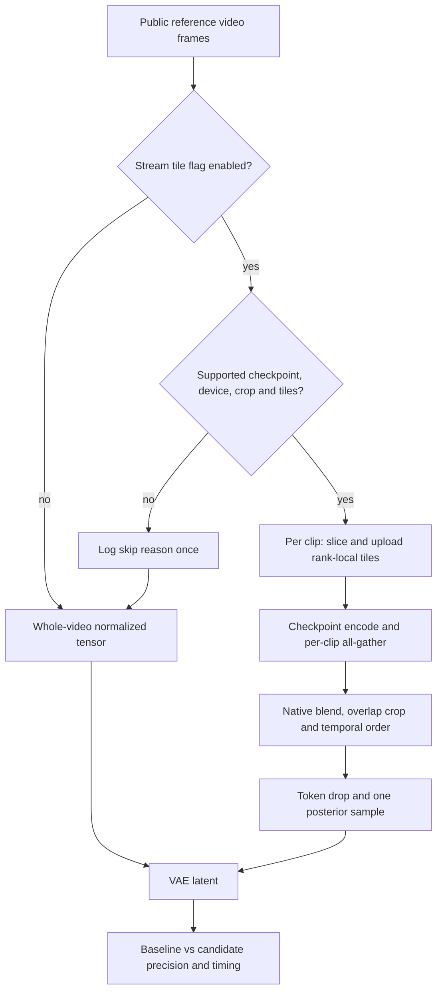

# RFC Design: Stream rank-local MiniMax-H3 reference-video tiles

## Problem

MiniMax-H3 reference-to-video requests encode the reference media before every
request's diffusion loop. The video VAE encode receives a uint8 frame array and,
on the ordinary path, materializes a whole-video normalized FP32 tensor on the
device before the checkpoint's tiled encoder starts. The full reference video
therefore stays resident for the whole encode, which competes for device memory
with the rest of the pipeline on high-resolution and long reference clips.

Public context: [vllm-project/vllm-omni#11003](https://github.com/vllm-project/vllm-omni/pull/11003).

## Proposal

Add an opt-in flag, `VLLM_OMNI_H3_VAE_STREAM_TILE`, that prepares and uploads
only the current rank's assigned spatial tiles for each temporal clip.

- Slice tile windows directly from the uint8 frame array on the host, per clip,
  and normalize each tile after upload.
- Reuse the checkpoint's own `split_tiles`, `encode`, `blend`, overlap and crop
  arithmetic so tile assignment, gather/blend order, temporal padding and the
  single posterior sample match the native tiled encode.
- Run one barrier and one all-gather per clip when the world size is greater
  than one, matching the native collective count.
- Keep the ordinary path for every case the fast path cannot reproduce exactly:
  unsupported devices, checkpoint contracts, crop modes, tile geometry, too few
  tiles for the participating ranks, or an unresolvable posterior sampler.
- Log a one-time skip reason so a fallback is observable instead of silent.
- Reuse the legacy preparation flag's truthy syntax; legacy preparation still
  takes precedence.

## Flow

## Compatibility

- Public API impact: one new environment variable, opt-in and disabled by
  default. No Python signature change.
- Runtime or dependency impact: none. The path uses existing collective and
  allocation primitives.
- Fallback behavior: legacy preparation wins when both flags are set; every
  unsupported case returns to the existing preparation path after a one-time
  log line.

## Risks

- Correctness risk: tile slicing, temporal padding or blend order could diverge
  from the native tiled encode. Mitigation: reuse the checkpoint's own split,
  encode and blend calls, and compare encoder rows bit-for-bit on eight ranks
  plus end-to-end outputs.
- Performance risk: the flag could appear to help while never being hit, or a
  stage-level memory saving could be mistaken for a device HBM peak. Mitigation:
  require an explicit stream-hit counter, treat allocator high-water marks as
  stage memory, and keep the latency claim neutral when the confidence interval
  includes zero.
- Maintenance risk: fast-path eligibility checks can drift from checkpoint
  contracts. Mitigation: centralize the gate, cover each rejected layout in CPU
  tests, and keep the fallback path unchanged.

## Open Questions

- Whether to shorten the repeated skip-log prefix with a shared helper; the
  current diff keeps one explicit line per reason for reviewability.
- Whether wider tile counts or additional checkpoint crops should be enabled
  after per-layout validation; the current gate is deliberately conservative.
- Integration with
  [#10167](https://github.com/vllm-project/vllm-omni/pull/10167) is deferred:
  both diffs textually conflict in `encode_video`, and whichever PR lands later
  must reconcile the order of the check sequence and the flag precedence. This
  PR validates independently and does not claim combined behavior.
