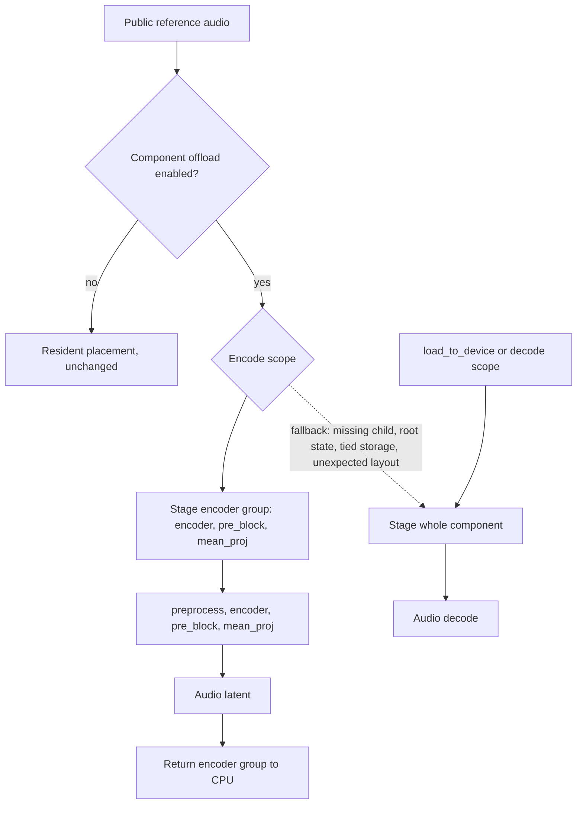

# RFC Design: Stage only MiniMax-H3 audio-encoder weights during reference encoding

## Problem

MiniMax-H3 reference-to-video requests prepare and encode the reference audio
before the diffusion loop. The audio VAE is one component with an encoder half
and a decoder half. The encode path uses `encoder`, the optional attention
projection `pre_block`, and `mean_proj`; the decoder half (`decoder`,
`dec_in_proj`, `logs_proj`) is only needed when audio latents are decoded.

The pipeline entered the whole audio-VAE component scope during reference
encoding, so the decoder weights were staged on the device at the same time as
the encoder. During the media-preparation stage that is pure residency cost: it
competes for device memory with the DiT and the later decode stages.

There is a second, independent defect. `encode_waveform` chose its device from
`next(self.model.parameters())`, that is, the first registered parameter of the
whole model. When only part of the model is staged, or when a decoder happens to
be registered first, the waveform can be moved to the wrong device even though
the encoder is on the accelerator.

Public context: [vllm-project/vllm-omni#11004](https://github.com/vllm-project/vllm-omni/pull/11004).

## Proposal

Partition the audio VAE into two residency groups and stage them independently:

- encoder group: `encoder`, `pre_block`, `mean_proj`;
- decoder group: every other child, including `logs_proj`.

Each group gets its own `PinnedModuleStager`. The encode scope drives the
encoder group through a lightweight part proxy; the decode scope and the public
`load_to_device()`/`offload_to_cpu()` contract keep staging the whole component,
so decode behavior is unchanged.

The proxy is shared with the video VAE: `_VideoVAEPartProxy` is generalized to
`_VAEPartProxy`, and the old name stays as an import alias for existing callers.
Model-level sequential offload unwraps the proxy to the real module because the
offload hook is registered on the module, not on the half.

Whole-component staging is kept when the split cannot be proven safe:

- a required child (`encoder`, `mean_proj` or `decoder`) is missing;
- the remote child layout is different from the expected single `model` child;
- the remote or model root itself has parameters or buffers;
- a tensor is shared between the two groups (tied storage, one tensor
  registered twice, or a zero-length view of a real backing tensor).

Every fallback logs its reason once at debug level, so a silent whole staging is
observable. Independent empty tensors do not collide: a zero storage address is
combined with object identity, while a zero-length view of a non-empty tensor
still counts as shared.

`encode_waveform` moves the waveform to
`next(self.model.encoder.parameters()).device`, the device of the group that
actually runs.

## Flow

## Compatibility

- Public API impact: none. No new environment variable and no Python signature
  change; `_VideoVAEPartProxy` remains importable.
- Runtime or dependency impact: none. The split uses the existing
  `PinnedModuleStager` and component-cache plumbing.
- Fallback behavior: whole-component staging remains the safe default, and the
  narrower scope applies to manual component offload. Resident placement
  retains the existing device placement. Model-level sequential offload follows
  the hooks on the real audio VAE. Encode-only adapters and unrecognized
  checkpoint layouts use whole-component staging when manually offloaded.
- Interaction with [#11005](https://github.com/vllm-project/vllm-omni/pull/11005) at [`80d6b6fc`](https://github.com/vllm-project/vllm-omni/commit/80d6b6fc200be3b7499a2e6d7113d75261c2bdd6). Both PRs change `encode_waveform`. A merge-tree test
  shows one text conflict there and an automatic merge for the recipe file. The
  two changes are independent and can coexist.

## Risks

- Correctness risk: a checkpoint could use modules outside the declared encoder
  group during `preprocess` or encode, or could share storage between the
  groups. Mitigation: the split is validated on the real public checkpoint, the
  `preprocess`/`encoder`/`pre_block`/`mean_proj` call placements are observed,
  and tied storage falls back to whole staging.
- Device-placement risk: the waveform device can be taken from the wrong scope.
  Mitigation: select it from the encoder parameters and test a decoder-first
  same-weight reorder in addition to the real registration order.
- Performance risk: a stage-level saving can be mistaken for a full-request
  peak reduction, or an E2E delta inside the noise band can be reported as a
  speed-up. Mitigation: keep the isolated stage and full-request peaks in
  separate tables, and report a confidence interval that includes zero as
  neutral.
- Maintenance risk: the partition rule can drift from the checkpoint layout.
  Mitigation: a single helper owns the partition, each rejected layout has a
  named fallback reason, and CPU tests cover each case.

## Open Questions

- Whether the `_VideoVAEPartProxy` alias should be removed once the video-side
  callers and tests are renamed; the current diff keeps it to stay small.
- Whether other checkpoint layouts with additional encode-side children should
  join the encoder group after per-layout validation; the current rule is
  deliberately conservative.
- The second merge can apply the conflict resolution in
  [review-response.md](review-response.md).
