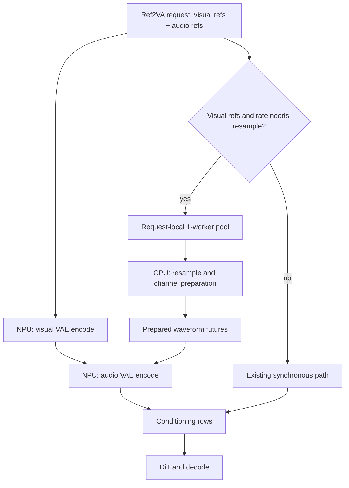

# RFC Design: Overlap MiniMax-H3 CPU audio preprocessing with visual encoding

## Problem

MiniMax-H3 reference-to-video requests on Ascend accept a reference video and
audio. When the reference audio sample rate is not the audio VAE rate (32 kHz),
the encoder leader encodes the visual references on the NPU first, and only
then performs the CPU part of audio preparation on the already loaded waveform
— cropping, channel handling and resampling — before the audio VAE encode.
Both steps run serialized in `encode_media`, so the NPU sits idle during CPU
resampling and the request pays the sum of the two instead of the maximum.

## Proposal

`encode_media` already owns the request-level sequence: visual references are
encoded first, then audio references. The change makes the CPU-only part of
waveform preparation start before the visual encode:

1. A request-local context manager creates a single-worker thread pool
   (`h3-audio-prepare`) and submits one preparation task per audio input.
2. Visual references, guide frames and video-edit inputs are encoded exactly as
   before.
3. The audio encode consumes each future before calling `encode_waveform`, then
   encodes the prepared waveform on the NPU.
4. On any exception the pool is shut down with `wait=True,
   cancel_futures=True`, so queued work is cancelled and the worker is joined
   before the error propagates. No thread or pool survives the request.

Waveform preparation itself is moved into a weights-free static helper
(`MiniMaxH3AudioVAE._prepare_waveform`) so a worker thread never touches model
parameters or accelerator state. The helper keeps the previous dtype, channel
order, channel selection and `torchaudio` resampling, and builds the resampling
filter under an explicit CPU device context when the source is a CPU tensor.

The overlap is enabled only when all of the following hold: conditioning is
being emitted, visual references exist, the audio VAE exposes the helper, CPU
autocast is not active, every waveform is already on CPU, and at least one
sample rate needs resampling. Everything else keeps the synchronous path, which
is why audio-only, native-rate, non-leader and CPU-autocast requests are
unaffected in behavior and thread usage.

No worker pool, cache or prepared waveform is shared across requests. The only
new state is the request-local pool and futures.

## Flow

## Compatibility

- **Public API impact**: none. `encode_media` keeps its signature and return
  contract; `MiniMaxH3AudioVAE.encode_waveform` keeps its public signature and
  `decode_only` guard.
- **Runtime or dependency impact**: one short-lived Python thread per eligible
  request. No new package dependency; `torchaudio` was already used.
- **Fallback behavior**: audio-only, native-rate, CPU-autocast and non-leader
  requests keep the previous synchronous preparation. A preparation failure is
  surfaced from the future, after the worker is joined, with the original
  exception.
- **Behavioral invariant**: waveform values, channel order, channel selection,
  resampling filter and output tensors are unchanged; the change is scheduling
  only.

## Risks

- **Correctness risk**: a worker thread touching accelerator state, or changing
  channel order, would change conditioning. Mitigated by the weights-free
  helper, explicit CPU device context and sample-exact unit tests.
- **Performance risk**: small requests can pay thread creation overhead; the
  gate only enables overlap when resampling is needed, and the measured
  component result is -1.202% wall time. On the fixed end-to-end request the
  change is within noise, so no E2E gain is claimed.
- **Maintenance risk**: the encoder leader now has concurrency that must keep
  cancellation and join semantics. Unit tests pin the failure path, the
  non-leader ordering and the no-worker fallbacks.

## Open Questions

- Whether a future change should also overlap the channel/crop work when no
  resampling is needed; this PR deliberately keeps that case synchronous.
- Whether the single sidecar thread should be measured under multi-reference
  contention on a busy host; not run in this validation.
