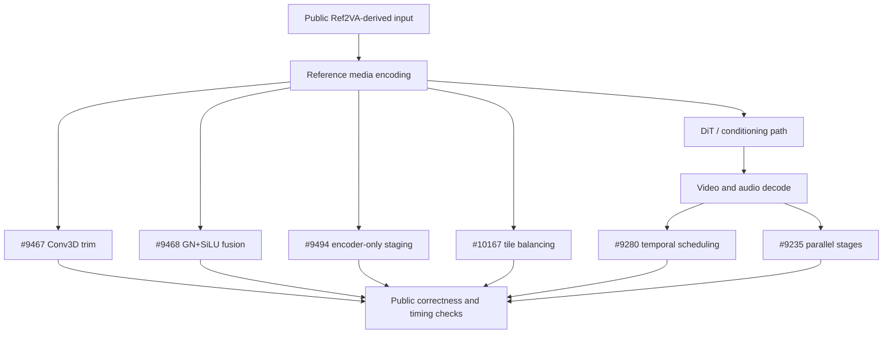

# RFC Design: MiniMax-H3 Ascend PR Group

## Problem

MiniMax-H3 media conditioning and VAE decode paths on Ascend contain several
independent latency opportunities. The public PR group keeps each optimization
small and reviewable while preserving public reproducibility.

## Proposal Map

| Area | PRs | Design intent |
| --- | --- | --- |
| Image/video reference encoding kernels | [#9467](https://github.com/vllm-project/vllm-omni/pull/9467), [#9468](https://github.com/vllm-project/vllm-omni/pull/9468) | Reduce encoder component work while preserving fallback paths and exact outputs. |
| Encoder residency and staging | [#9494](https://github.com/vllm-project/vllm-omni/pull/9494) | Stage only the encoder component when decoding is not needed for media encoding. |
| Video VAE encode scheduling | [#10167](https://github.com/vllm-project/vllm-omni/pull/10167) | Balance temporal tile work across ranks/clips with exact latent outputs. |
| Video VAE decode scheduling | [#9280](https://github.com/vllm-project/vllm-omni/pull/9280) | Select geometry windows that reduce decoder latency without changing tensors. |
| Native decode parallelism | [#9235](https://github.com/vllm-project/vllm-omni/pull/9235) | Split video and audio decode stages across the same 8-NPU pool and join outputs safely. |

## Flow

## Compatibility

- Public API: no private inputs or private environment assumptions are required
  for the archived validation.
- Runtime: validation uses a public Ascend-compatible lane and records the
  public base/candidate split.
- Fallbacks: PRs that add optimized kernels or routing keep original paths for
  unsupported dtype/layout/runtime conditions.

## Review Principles

- One PR per optimization topic.
- Avoid extra public switches when the behavior can be inferred from existing
  runtime/config ownership.
- Prefer exact component validation before making any end-to-end speed claim.
- Report component, HTTP/E2E, precision, profile, and not-run items separately.
