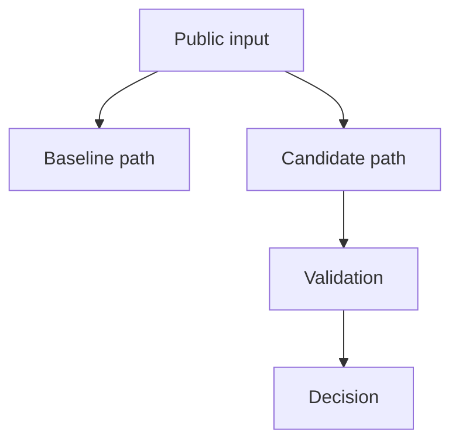

# RFC Design Template

## Problem

Describe the public user-visible problem and link to the public issue or PR.

## Proposal

Explain the design in a few paragraphs. Keep implementation details tied to
public source files.

## Flow

## Compatibility

- Public API impact:
- Runtime or dependency impact:
- Fallback behavior:

## Risks

- Correctness risk:
- Performance risk:
- Maintenance risk:

## Open Questions

-
